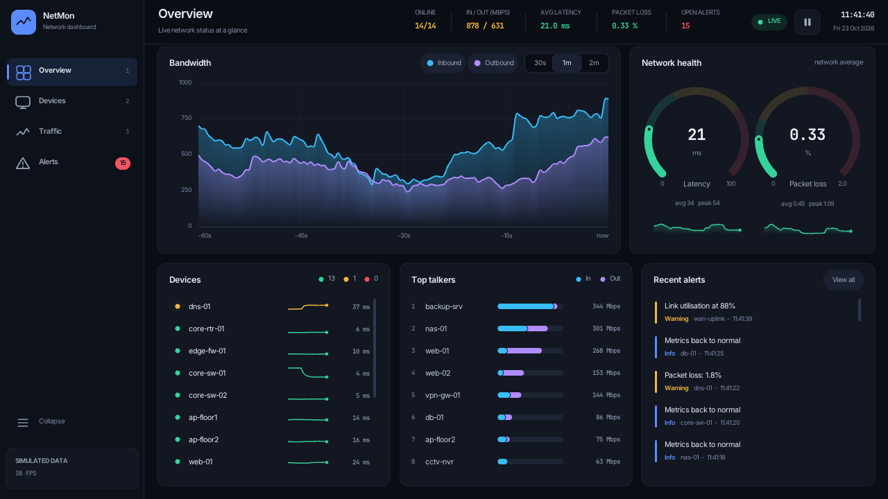
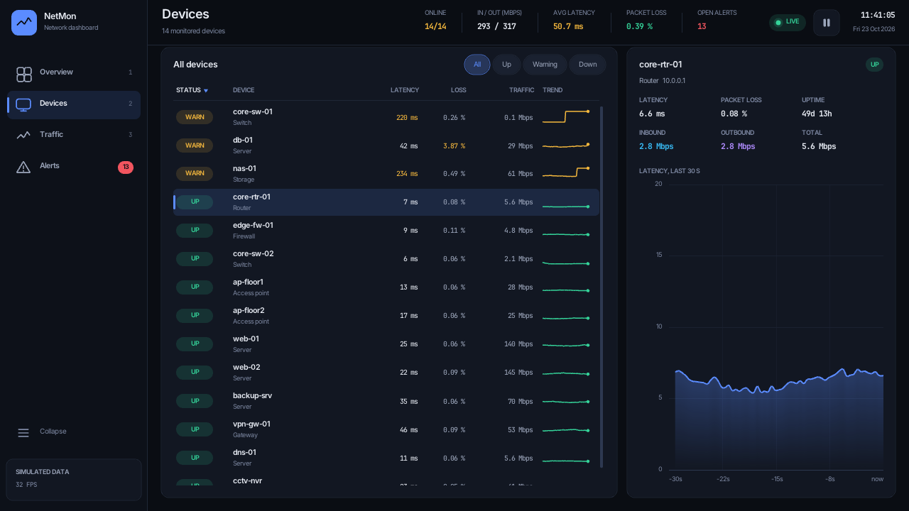
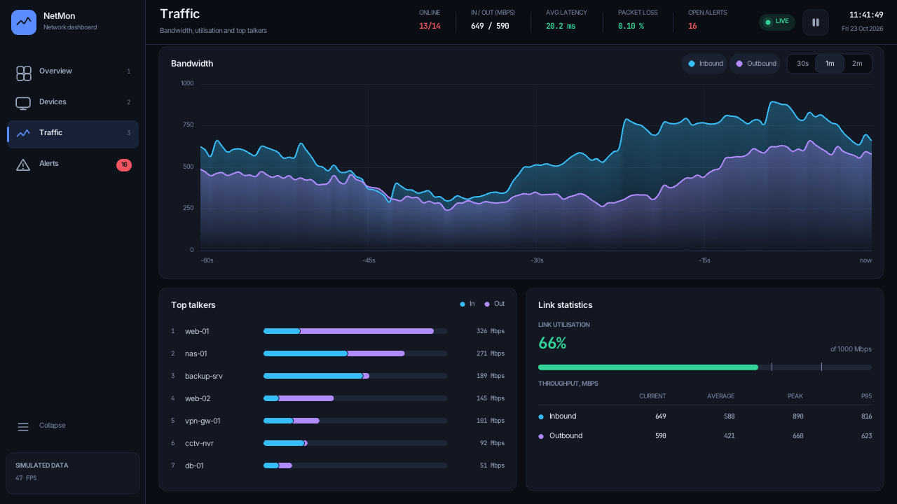
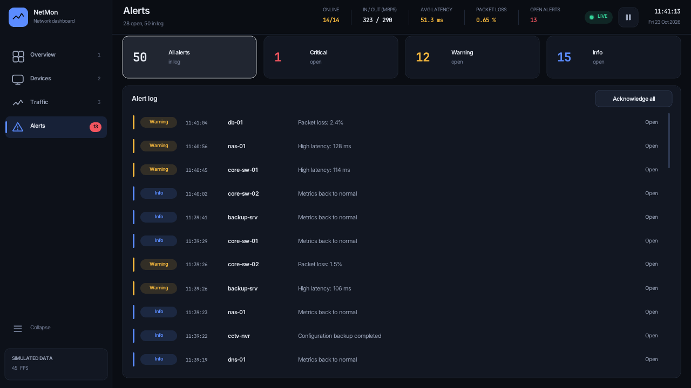
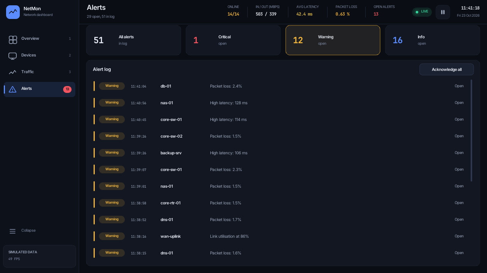

# Network Monitoring Dashboard

A real-time network monitoring dashboard written in C99 with [Raylib](https://www.raylib.com/).
It shows bandwidth, device health, latency, packet loss and alerts on one screen, with a dark
theme, smooth animation and four pages. This is a **prototype that runs on simulated data**
(see [Scope and design decisions](#scope-and-design-decisions)).



## Why network monitoring matters

A network fails quietly: a saturated uplink, a switch that starts dropping packets or an access
point that has gone offline shows up first as "everything is slow". Monitoring puts the numbers
that explain this in one place:

- **Bandwidth**: who is using the link, and is it close to capacity?
- **Device health**: which devices are up, degraded or down?
- **Latency and packet loss**: the two measures users feel first.
- **Alerts**: a log of what changed and when, so an outage is noticed in seconds, not when the
  first support ticket arrives.

## Who it is for

- **Small network administrators** who want one screen instead of logging in to each device.
- **Helpdesk staff** who need to see quickly whether a complaint is a network problem.
- **Labs and classrooms** that want a self-contained monitoring demo with no hardware or
  privileges required.

## Scope and design decisions

- **Simulated data.** All numbers come from generators inside the program: mean-reverting random
  walks and sine components for traffic and latency, plus a fault injector that degrades or takes
  devices offline at random. Nothing is read from a real network, so it runs anywhere with no
  privileges. It is a prototype and **not a production monitoring system**.
- **Replaceable data layer.** The simulation (`src/data.[ch]`) does not depend on Raylib. The UI
  reads it only through a `Dataset` struct and a few query functions (summary, top talkers). A
  real source (SNMP polling, NetFlow, ICMP ping) could fill the same structures without touching
  the drawing code. No such collector exists yet.
- **Read-only by design.** The dashboard observes and alerts. It never changes the network:
  blocking traffic, configuring devices or quarantining hosts belongs to firewall and NAC tools.
  The only actions are in the dashboard itself: acknowledging alerts, filtering, sorting and
  pausing the display.
- **Immediate-mode UI, no dependencies.** The only dependency is Raylib; widgets are plain
  function calls drawn every frame.

## Features

### Overview

Everything at a glance: live inbound/outbound bandwidth with a selectable window (30 s, 1 m,
2 m), latency and packet-loss gauges with threshold zones and sparklines, a compact device list,
the current top talkers and the most recent alerts. Clicking a device or talker opens it on the
Devices page, and "View all" opens the full alert log.

### Devices



A table of all 14 devices with status (up, warning, down), latency, packet loss, traffic and a
trend sparkline. Filter by status, sort by any column (click again to reverse; the screenshot
sorts problem devices first). Selecting a row opens a detail panel with six metrics and a live
latency chart.

### Traffic



A large bandwidth chart with spline smoothing, auto-scaling axis, series toggles and a hover
crosshair with tooltip. Below it: the top-talkers bar chart (re-ranks with animation) and link
statistics: utilisation against the 1000 Mbps capacity, plus current, average, peak and 95th
percentile throughput per direction.

### Alerts



The full alert log with severity cards (critical, warning, info) that double as filters. New
alerts slide in; clicking an entry acknowledges it, and "Acknowledge all" clears the list.
Alerts are raised when a device changes status (latency or loss crossing a threshold, outage,
recovery) or when link utilisation passes 85 %.



### Header and sidebar

The header shows the clock and date, online devices, total in/out rate, average latency, packet
loss and open alerts, plus a LIVE/PAUSED indicator and pause button. The sidebar has the page
buttons with an alert badge and can be collapsed. The layout adapts down to 960x600.

## Controls

| Input                                | Action                                      |
| ------------------------------------ | ------------------------------------------- |
| `1` `2` `3` `4`                      | Overview, Devices, Traffic, Alerts          |
| `Space`                              | Pause / resume the simulation               |
| `B`                                  | Collapse / expand the sidebar               |
| `F11`                                | Toggle borderless fullscreen                |
| Mouse wheel / drag scrollbar         | Scroll lists                                |
| Click a device or top talker         | Open that device on the Devices page        |
| Click an alert                       | Acknowledge / un-acknowledge it             |
| Click a table header                 | Sort by column (click again to reverse)     |
| Click a severity card or status chip | Filter alerts / devices                     |
| Hover a chart                        | Crosshair and tooltip with the sample value |

## How it works

### Architecture

| Module       | Files                                   | Role                                                                    |
| ------------ | --------------------------------------- | ----------------------------------------------------------------------- |
| data         | `data.[ch]`                             | Simulation: devices, fault injection, history rings, alert log, queries |
| theme        | `theme.[ch]`                            | Palette, spacing scale, font loading, text helpers                      |
| ui           | `ui.[ch]`, `anim.h`                     | Immediate-mode toolkit: input, animation slots, clipping, widgets       |
| charts       | `charts.[ch]`                           | Line chart, arc gauge, stacked bars, sparkline                          |
| panels       | `panels.[ch]`                           | Cards shared by several pages                                           |
| pages        | `page_*.c`, `pages.h`                   | The four page layouts                                                   |
| shell        | `shell.c`                               | Sidebar and header                                                      |
| dashboard    | `dashboard.[ch]`, `main.c`              | Application state, shortcuts, the frame loop and the window             |

Dependencies point one way: `data` knows nothing about drawing, `charts` knows nothing about
the application, and pages compose panels, which compose charts and widgets.

### The frame loop

`main.c` opens a 1280x720 resizable window (4x MSAA, 60 FPS target) and calls `dashboard_frame`
once per frame:

1. Read input and shortcuts, advance the simulation (unless paused), compute the summary.
2. Skip drawing when the window is minimised.
3. Compute the content rectangle beside the sidebar and below the header.
4. Draw the active page.
5. Draw the page fade-in veil (about 170 ms).
6. Draw the sidebar and header, then the tooltip on top.

### Simulation and animation

`data_update()` advances the simulation in fixed 0.5 s ticks, independent of the frame rate.
Each tick steps every device (latency noise, load random walk, optional degradation or outage),
records history and raises alerts on status transitions. A device turns to warning at 100 ms
latency or 1.5 % loss, with hysteresis so it does not flicker. Charts scroll continuously
between ticks using the sub-tick offset, so motion stays smooth at 60 FPS while data arrives at
2 Hz.

Widget state that must survive between frames (hover fades, scroll offsets, animated row
positions) lives in a fixed table of slots keyed by hashed IDs, with least-recently-used
eviction. All animation uses frame-rate independent smoothing.

## Building and running

Requirements: a C99 compiler, `make` or CMake 3.14+, and `git` (Raylib 5.5 is fetched from
GitHub when it is not installed). An OpenGL 3.3 capable driver is needed to run.

### Linux

Install the Raylib build dependencies (Debian / Ubuntu):

```sh
sudo apt install build-essential git cmake libx11-dev libxrandr-dev libxinerama-dev \
                 libxcursor-dev libxi-dev libgl1-mesa-dev
```

Fedora: `sudo dnf install gcc make git cmake libX11-devel libXrandr-devel libXinerama-devel libXcursor-devel libXi-devel mesa-libGL-devel`

With make (clones Raylib into `third_party/` on first build):

```sh
make -j
make run
```

With CMake:

```sh
cmake -S . -B build
cmake --build build -j
./build/netmon
```

Use an installed Raylib instead with `make RAYLIB_SYSTEM=1`.

### Windows

Using MSYS2 (MinGW-w64 shell):

```sh
pacman -S mingw-w64-x86_64-gcc mingw-w64-x86_64-cmake mingw-w64-x86_64-make git
cmake -S . -B build -G "MinGW Makefiles"
cmake --build build -j
build\netmon.exe
```

Using Visual Studio (Developer Command Prompt):

```bat
cmake -S . -B build
cmake --build build --config Release
build\Release\netmon.exe
```

The CMake build copies `assets/` next to the executable. Fonts are looked up relative to the
executable and the working directory; if they are missing the dashboard falls back to Raylib's
built-in font.

### Tests

The simulation layer has no Raylib dependency and is covered by headless tests (ring buffers,
determinism, invariants, alert log, ranking):

```sh
make test                # builds with AddressSanitizer and UBSan
ctest --test-dir build   # when configured with CMake
```

### Known limitations

- Developed and tested on Linux. The Windows instructions follow Raylib's toolchains but the
  Windows build has not been run.
- 60 FPS was not confirmed on real GPU hardware; on a software OpenGL renderer the frame rate
  is lower (the sidebar shows the current FPS).
- No high-DPI scaling; fonts are fixed pixel sizes and cover Latin-1 only.

## Project layout

```text
.
├── src/
│   ├── main.c            window setup and the main loop
│   ├── dashboard.[ch]    application state, shortcuts, frame loop
│   ├── shell.c           sidebar and header
│   ├── panels.[ch]       cards shared by several pages
│   ├── pages.h           page entry points
│   ├── page_overview.c   Overview page
│   ├── page_devices.c    Devices page
│   ├── page_traffic.c    Traffic page
│   ├── page_alerts.c     Alerts page
│   ├── ui.[ch]           immediate-mode toolkit
│   ├── charts.[ch]       line chart, gauge, bars, sparkline
│   ├── theme.[ch]        palette, spacing, fonts
│   ├── anim.h            easing and smoothing
│   └── data.[ch]         simulation (no Raylib dependency)
├── tests/test_data.c     headless tests for the simulation
├── assets/fonts/         Inter and JetBrains Mono (SIL Open Font License)
├── docs/screenshots/     images used in this README
├── Makefile              Linux build, run and test targets
└── CMakeLists.txt        cross-platform build
```

## Authors

Illia Karban and Mantas Bielevicius.
